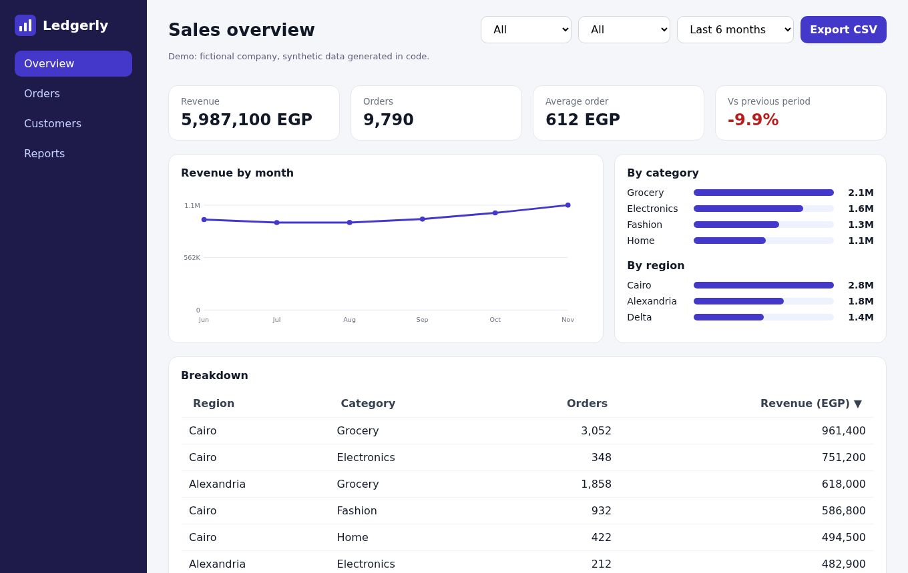
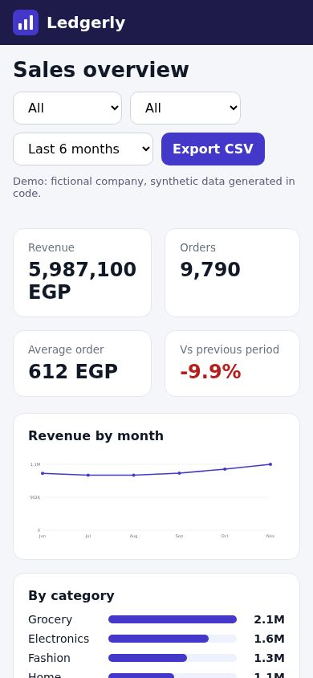

# Ledgerly Sales Dashboard (React + Vite)

An analytics dashboard demo for a fictional retailer. All data is synthetic and generated deterministically in code. Charts are plain SVG.

## Features
- Filters for region, category and period (3, 6, 12 months)
- KPIs: revenue, orders, average order value, change vs previous period
- Monthly revenue line chart, category and region bars
- Sortable breakdown table and CSV export

## Run
```bash
npm install
npm run dev
npm run build
```

## Demo video
[docs/demo.mp4](docs/demo.mp4)

## Preview



## Tests
Headless Chrome checks (24). KPI values are compared with figures computed independently from the raw data for several filter combinations, plus sorting, CSV rows, chart points, mobile overflow and console errors.
